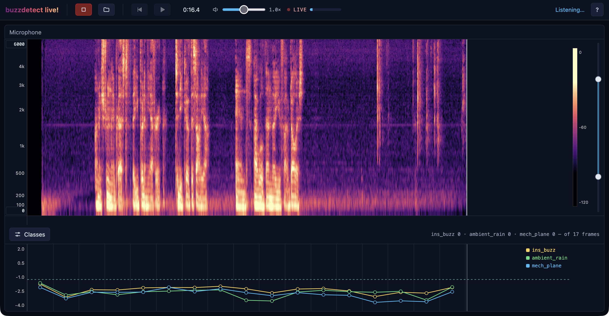

# buzzdetect live!


A playground for quickly running buzzdetect from your browser!

This is only a playground, I strongly recommend that you use [the real buzzdetect](https://github.com/OSU-Bee-Lab/buzzdetect) for real analyses. At the very least because I don't have a button to export results from the playground...

This runs buzzdetect's own released models, `fast_v1`, `balanced_v1` and `heavy_v1`, picked from the dropdown beside the Neurons button. They're the same ONNX files the desktop app runs, unmodified, so results match buzzdetect to float32 noise (worst case under 3e-6 on the demo clip). Every neuron's suggested threshold is 0, because buzzdetect-training shifts each model's outputs so that it is.

## What it do

You can open an existing audio file or else record live from your microphone. The audio will build into a spectrogram in the top panel, the model will be applied to the audio, and the model results are plotted to the lower panel. When recording, the spectrogram and results will stream in in real-time, which is cool.

All processing is local; the version I'm hosting at [lukehearon.com/buzzdetect-live](https://lukehearon.com/buzzdetect-live) doesn't ever upload anything!

Oh, it works on mobile, too!

```         
npm install
npm run dev      # http://localhost:5180
npm test         # parity against buzzdetect's own numbers
```

## Where the models come from
This part was written by Claude. Here it is for good ol' posterity.

buzzdetect's models are single ONNX graphs, waveform in and activations out,
with the log-mel front end, the trunk and the head fused by buzzdetect-training's
export. Nothing is built here. `tools/models.py` copies each model's `model.onnx`
and `config_model.json` into `public/model/<name>/` after checking both against
the sha256 in buzzdetect's `models.json`. It also writes
`public/sample/testbuzz.reference.json`, which holds buzzdetect's own `OnnxModel`
output for the demo clip and is what both parity checks compare against.

Run it with the buzzdetect engine's own venv, from the engine directory:

```
cd ~/Documents/bioacoustics/buzzdetect/engine
.venv/bin/python ~/Tools/buzzdetect-live/tools/models.py
```

The fp32 graphs are shipped rather than the `model.fp16.onnx` siblings. The fp16
files are half the download, but buzzdetect documents them as about 2e-2 off,
so `heavy_v1` is 21 MB. It's only downloaded when you pick it.

Each inference batch is given one spare frame of look-ahead audio. `heavy_v1`'s
activation for a frame depends on audio past the frame's own end. Without that
spare frame, the last frame of every batch would be computed against padding
and move by up to 0.5. With it, any batch size agrees with running the whole
file at once. buzzdetect's engine now does the same at its own chunk seams.
Releases up to 2.1.0 scored each chunk's last frame against zeros, so those
frames (one every chunklength seconds) are where results from those versions
differ. At the end of a file both pad with zeros and agree.
